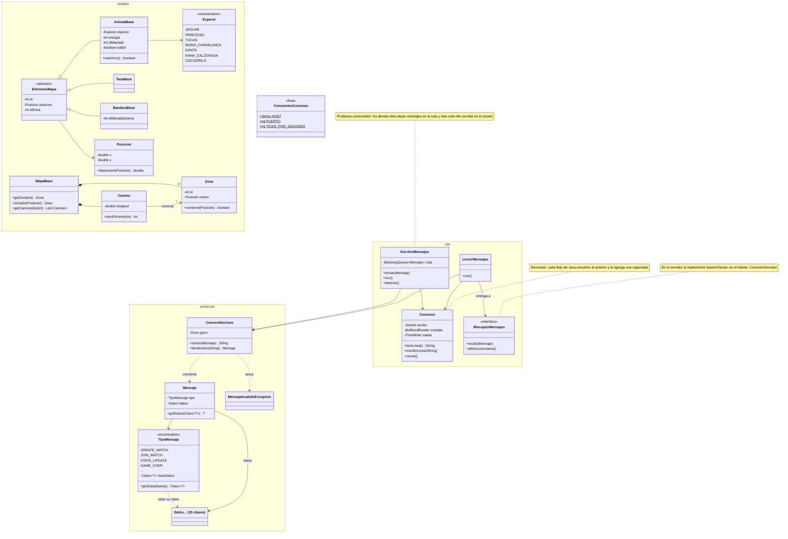

# Jungle Attack — Librería común

Caso #2 de Programación Orientada a Objetos, Tecnológico de Costa Rica.

**Autores:** Ignacio Hernández Camacho y Julian Moya

*Jungle Attack* es un juego de batalla para dos jugadores, construido como tres proyectos: el [servidor](https://github.com/IgnacioHdzz/caso2-servidor-POO), el [cliente](https://github.com/IgnacioHdzz/caso2-cliente-POO) y esta librería, que los otros dos comparten. La explicación del juego, cómo se juega y la arquitectura completa están en el [README del cliente](https://github.com/IgnacioHdzz/caso2-cliente-POO).

## Para qué existe

El servidor y el cliente son dos programas distintos, pero tienen que hablar el mismo idioma, los mismos tipos de mensaje, con los mismos datos, escritos de la misma forma. También necesitan conocer las mismas piezas del juego (una zona, un camino, un animal, una taza). Si cada proyecto tuviera su propia copia de esas clases, cualquier cambio en una tendría que repetirse en la otra.

Por eso todo lo compartido vive aquí, en un solo lugar. La librería tiene tres partes:

- **`comun.protocolo`**: los mensajes que viajan por la red y su conversión a JSON.
- **`comun.red`**: la lectura y escritura de mensajes por un socket, con sus hilos.
- **`comun.modelo`**: las clases base del juego. Cada programa las extiende con lo que solo él necesita: el servidor les agrega el comportamiento (moverse, atacar) y el cliente, lo visual.

## El protocolo

Cada mensaje es un objeto JSON en **una sola línea**, con dos campos: `type`, el tipo de mensaje, y `payload`, sus datos. Por ejemplo, cuando un jugador quiere crear una partida, el cliente envía:

```json
{"type":"CREATE_MATCH","payload":{"nickname":"Ignacio"}}
```

Que cada mensaje termine en un salto de línea es lo que permite separarlos: quien lee solo tiene que leer una línea completa para tener un mensaje completo.

El cliente envía **intenciones** (lo que el jugador quiere hacer) y el servidor responde con **hechos** (lo que realmente pasó). El cliente nunca decide nada del juego por su cuenta.

| Tipo | Dirección | Significado |
|---|---|---|
| `CREATE_MATCH` | cliente → servidor | Quiero crear una partida, con este nickname |
| `JOIN_MATCH` | cliente → servidor | Quiero unirme a la partida con este código |
| `SELECT_ANIMAL` | cliente → servidor | Elijo esta especie |
| `MOVE_ANIMALS` | cliente → servidor | Muevan estos animales a este punto |
| `ATTACK` | cliente → servidor | Que estos animales ataquen a este objetivo |
| `VIEW_ZONE` | cliente → servidor | Quiero ver esta zona del mapa |
| `MATCH_CREATED` | servidor → cliente | Tu partida está creada; este es su código |
| `MATCH_JOINED` | servidor → cliente | Ya estás en una partida con un rival |
| `ANIMAL_SELECTION` | servidor → cliente | Así va la elección de especies |
| `OPPONENT_LEFT` | servidor → cliente | Tu rival se fue antes de empezar |
| `GAME_STARTED` | servidor → cliente | Empieza el juego: el mapa, tu manada y tu zona |
| `STATE_UPDATE` | servidor → cliente | Lo que ves ahora mismo (unas 20 veces por segundo) |
| `GAME_OVER` | servidor → cliente | Terminó la partida: el ganador y el resumen |
| `ERROR` | servidor → cliente | No se pudo hacer lo que pediste, y por qué |

Cada tipo tiene su propia clase de datos en `comun.protocolo.datos` (por ejemplo, `CREATE_MATCH` lleva un `DatosCrearPartida`). Son clases pequeñas e inmutables, solo tienen un constructor y sus getters.

## Diagrama de clases



## Cómo funciona

### Enviar y recibir un mensaje

Para enviar, `ConvertidorJson` convierte el `Mensaje` en una línea de texto JSON usando Gson. Para recibir, hace lo contrario: lee el campo `type`, le pregunta a `TipoMensaje` qué clase de datos le corresponde y le pide a Gson que construya un objeto de esa clase con el `payload`. Si la línea no es un JSON válido o el tipo no existe, lanza una `MensajeInvalidoException`, y quien la estaba leyendo simplemente descarta esa línea.

Quien recibe el mensaje lo abre con `getDatos`, indicando la clase que espera: `mensaje.getDatos(DatosEstado.class)` devuelve directamente un `DatosEstado`, sin que haya que convertirlo a mano.

### Los hilos de una conexión

Cada conexión, tanto en el servidor como en el cliente, usa dos hilos de esta librería.

`LectorMensajes` se queda esperando líneas del socket. Cada vez que llega una, la convierte en mensaje y se la entrega a su receptor. Cuando la conexión se cierra, del lado que sea, cierra el socket de su parte y le avisa al receptor con `alDesconectarse()`.

`EscritorMensajes` es el único hilo que escribe en el socket. Los demás solo dejan mensajes en su cola y siguen con lo suyo. Así, si varios hilos envían al mismo tiempo, los mensajes nunca se mezclan a media línea, y nadie se queda esperando a que la red termine de escribir.

`LectorMensajes` no sabe a quién le entrega los mensajes: solo conoce la interfaz `IReceptorMensajes`. Gracias a eso, el mismo lector sirve para el servidor y para el cliente, y cada uno decide qué hacer con lo que llega.

## Patrones y decisiones de diseño

**Decorator.** El patrón Decorator agrega capacidades a un objeto envolviéndolo en otro que tiene la misma forma, en lugar de crear una subclase para cada combinación. Los flujos de Java están hechos así, y `Conexion` lo aprovecha: el flujo de bytes del socket se envuelve en uno que entiende caracteres en UTF-8, y ese, en uno que sabe leer líneas completas (`BufferedReader`) o escribirlas (`PrintWriter`). `Conexion` esconde todo eso detrás de tres métodos simples: leer una línea, escribir una línea y cerrar.

**Productor-consumidor.** Este patrón separa a quien produce trabajo de quien lo consume, comunicándolos con una cola. En `EscritorMensajes`, cualquier hilo puede producir mensajes y un solo hilo los consume y los escribe. La cola es una `BlockingQueue`: cuando está vacía, el hilo escritor espera dormido, sin gastar procesador. Para detenerlo se le envía un mensaje especial, `FIN`, que le indica que termine.

**El tipo de mensaje conoce la clase de sus datos.** Cada valor de `TipoMensaje` guarda la clase de los datos que lleva. Así, `ConvertidorJson` no necesita un `switch` con los 14 tipos para saber qué construir: se lo pregunta al tipo. Agregar un mensaje nuevo es agregar un valor al enum y su clase de datos.

**Clases base que cada lado extiende.** El servidor y el cliente necesitan cosas muy distintas de un animal: al servidor le importa cómo se mueve y ataca, y al cliente, cómo se dibuja. Por eso aquí solo están los datos que los dos conocen (`AnimalBase`, `TazaBase`, `BanderaBase`, `MapaBase`), y cada programa los extiende. Cuando el servidor envía un animal, envía solo su parte base, con un constructor de copia. Esto tiene una razón concreta: el animal del servidor conoce a su manada y la manada conoce a sus animales, y Gson no puede convertir a JSON un objeto que se apunta a sí mismo en círculo. La parte base no tiene esa referencia, así que se convierte sin problemas.

## Cómo usarla

El servidor y el cliente la usan como dependencia de Maven, así que hay que instalarla en el repositorio local de Maven **antes** de compilar cualquiera de los dos:

```
mvn install
```

Ese comando compila la librería, corre sus pruebas y la deja disponible para los otros proyectos. Si se cambia algo aquí, hay que volver a ejecutarlo.

Las pruebas están en `src/test/java` y se corren con `mvn test`. Revisan las clases base del modelo: posiciones y distancias, zonas y caminos, la búsqueda de zonas en el mapa y las copias de los elementos.
